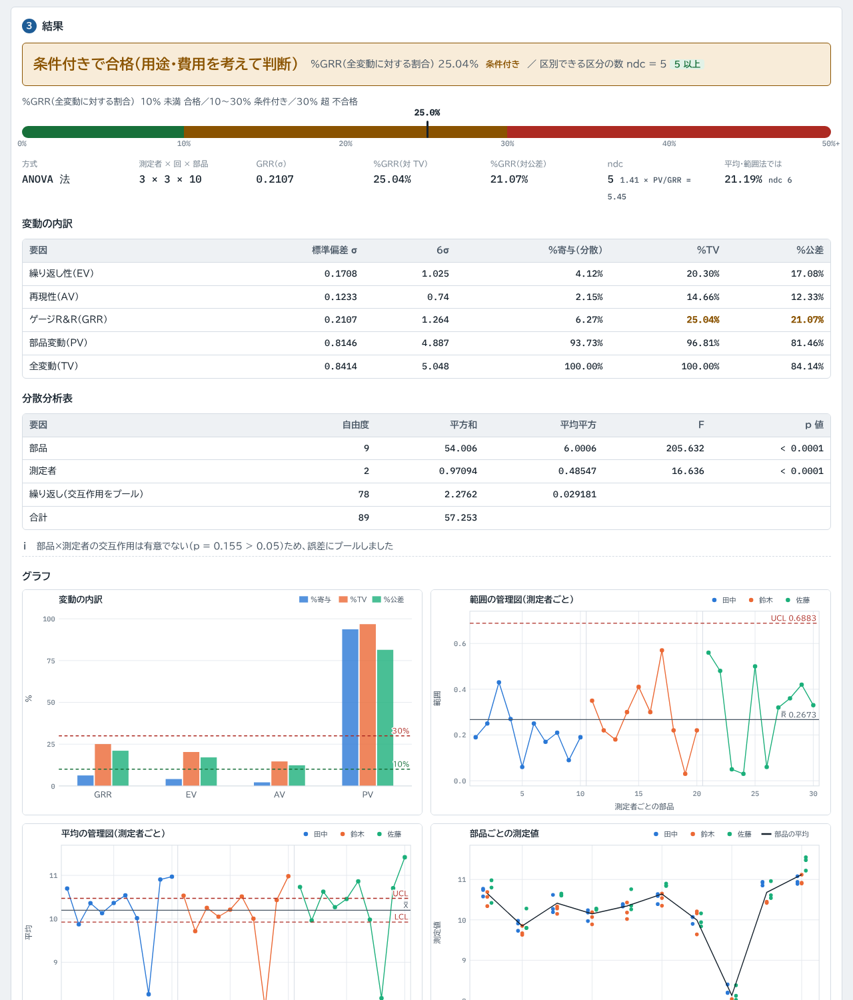
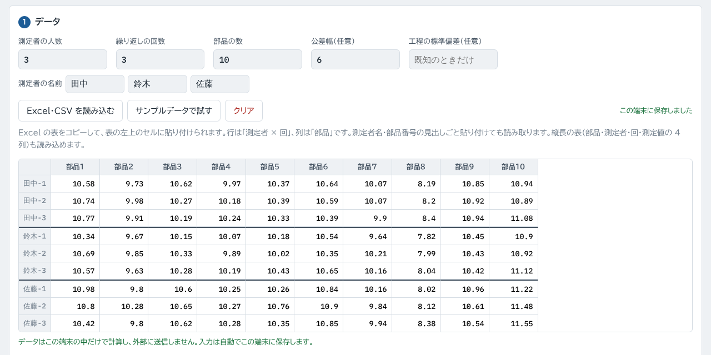
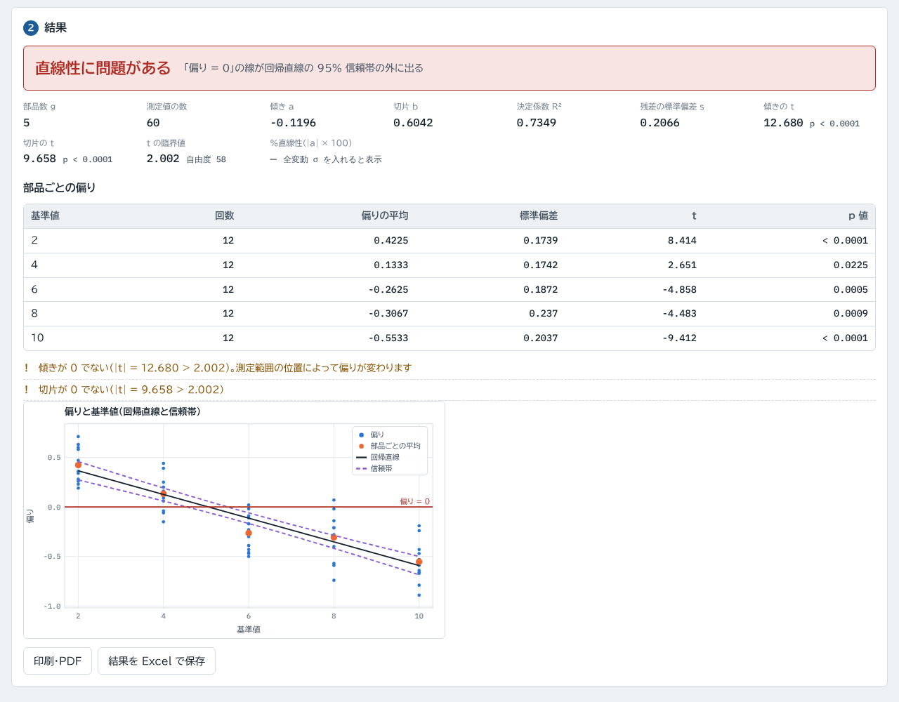
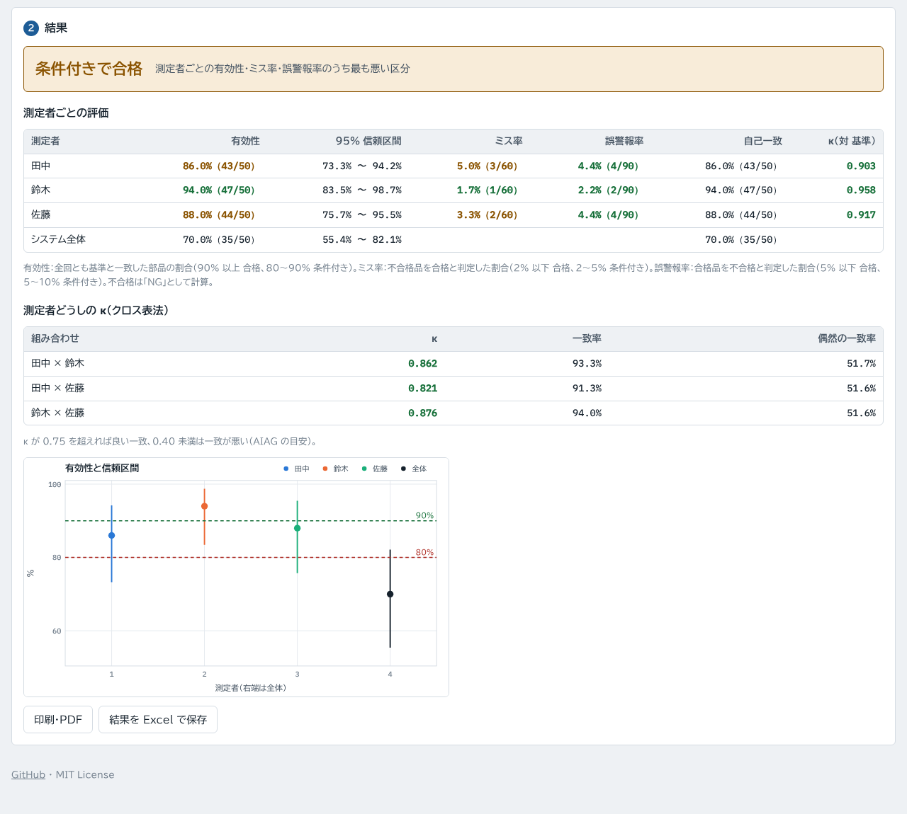

# 測定システム解析（msa-calc）

測定システム解析（MSA）を行う Web ツールです。**ゲージR&R**（ANOVA 法・平均・範囲法）、**偏り・直線性・安定性**、**Type-1（Cg・Cgk）**、**計数値の κ・有効性**を計算します。手順と判定基準は AIAG『Measurement Systems Analysis』第4版に合わせています。

**https://kotaooka.github.io/msa-calc/**

インストールは不要で、ブラウザで開くだけで使えます。

- **入力したデータやファイルは、この端末の外に送りません**。ファイルの読み込みと計算はすべてブラウザの中で行います
- 画面の字体（BIZ UDPゴシック・IBM Plex Mono）は Google Fonts から読み込むため、開いたときに Google のサーバーへ接続します
- 入力した値はこの端末のブラウザに自動で保存し、次に開いたときに続きから使えます
- 一度開けば**オフラインでも動きます**。スマートフォンやPCにアプリとして追加することもできます

---

## できること

各タブで「サンプルデータで試す」を押すと動作を確認できます。データは表に直接入力するほか、**Excel でコピーした範囲を表の左上のセルに貼り付ける**か、Excel（.xlsx）・CSV を読み込みます。

### ゲージR&R（計量値）

測定者 2〜10 人 × 繰り返し 2〜10 回 × 部品 2〜50 個のデータから、繰り返し性（EV）・再現性（AV）・交互作用（IA）・GRR・部品変動（PV）を求めます。

- 表は AIAG のデータシートと同じく、行が「測定者 × 回」、列が「部品」です。**測定者名・部品番号の見出しごと貼り付けても読み取ります**。縦長の表（部品・測定者・回・測定値の 4 列）も読み込めます
- **ANOVA 法**：分散分析表（p 値つき）を表示します。交互作用が有意でなければ誤差にまとめて（プールして）計算します。プールの有意水準は変えられ、常に交互作用を残すこともできます
- **平均・範囲法**：範囲の管理図で限界を超えた測定を知らせます。係数 K1・K2・K3 は数値積分で求めた値と、マニュアルの表の値（4 桁）を選べます
- **判定**：%GRR（全変動に対する割合、または公差に対する割合）を 10% 未満 合格／10〜30% 条件付き／30% 超 不合格で判定し、区別できる区分の数（ndc）が 5 以上かも確認します。既知の工程の標準偏差を全変動として使うこともできます
- **グラフ**：変動の内訳、範囲・平均の管理図（測定者ごと）、部品ごと・測定者ごとの測定値、部品 × 測定者の平均（交互作用）

### 偏り・直線性・安定性

| タブ | 内容 |
|---|---|
| 偏り | 基準部品の繰り返し測定から、偏りの t 検定と信頼区間（独立サンプル法） |
| 直線性 | 偏りを基準値に回帰し、「偏り = 0」の線が信頼帯に収まるかを判定。傾き・切片の t 検定、%直線性 |
| 安定性 | 基準部品を定期的に測った値の X̄-R 管理図（サブグループサイズ 1 なら I-MR）。JIS Z 9020-2 の 8 ルールで判定 |

### Type-1（Cg・Cgk）

1 つの基準部品を 25〜50 回続けて測った値から Cg・Cgk を計算します。AIAG MSA 第4版には含まれない評価で、一般的な式（K = 20%、L = 6σ、下限 1.33。いずれも変更可）で計算します。

### 計数値（合否判定など）

部品ごとに基準の判定と、測定者ごと・回ごとの判定を入れます（OK/NG、1/0、合格/不合格 など）。

- 測定者どうし・基準との κ（クロス表法）
- 測定者ごとの有効性（95% 信頼区間つき）・ミス率・誤警報率・自己一致、システム全体の有効性
- AIAG の基準（有効性 90%・80%、ミス率 2%・5%、誤警報率 5%・10%、κ 0.75・0.40）で判定

### 保存

結果の Excel ファイル、印刷・PDF、グラフの PNG。

---

## 使うときの注意

- ゲージR&R・計数値は、すべてのセルに値がそろった計画（クロス計画）だけを扱います。入れ子（破壊試験など）の計画には対応していません
- **旧形式の .xls は読めません**。Excel で .xlsx に保存し直してください。CSV は UTF-8 と Shift_JIS に対応しています
- 平均・範囲法の係数を数値積分の値で計算すると、マニュアルの例題（4 桁の係数で計算）と 4 桁目が違うことがあります。突き合わせるときは「マニュアルの表の値を使う」を選んでください
- 計算結果は判断材料としてお使いください

---

## 計算の検証

計算は外部ライブラリを使わずに実装し、別の方法で計算した値と照合するテストを付けています（push のたびに GitHub Actions で実行）。

- 範囲の分布の係数 d2・d3・d2*：scipy の数値積分（範囲の確率密度から求める、別経路の式）と照合。マニュアルの K1・K2・K3 の表の値とも照合
- ゲージR&R：5 通りの計画（交互作用あり・測定者差大・部品差小など）で、平均・範囲法と、statsmodels の分散分析から求めた分散成分・p 値・%GRR・ndc を照合
- 偏り・直線性：scipy の t 検定・回帰（linregress）と、信頼帯の値を照合
- 計数値：scikit-learn の κ、scipy のベータ分布による正確な信頼区間と照合
- 表の読み取り（見出しつき・結合セル・縦長の表など）

### 公開されている認証値との照合

上の照合は「自分で別に計算した値」との比較です。これとは別に、答えが公開されているデータでも確かめています（`tests/published.js`、push のたびに実行）。使っているのは、米国国立標準技術研究所（NIST）が統計ソフトの計算精度を確かめるために公開している [Statistical Reference Datasets（StRD）](https://www.nist.gov/itl/products-and-services/statistical-reference-datasets) で、認証値が 15 桁で示されています。

| 計算 | 使ったデータ | 結果 |
|---|---|---|
| ゲージR&R（ANOVA 法）の平方和・EV | 分散分析データ 11 組（SiRstv、AtmWtAg、SmLs01〜09。最大 18,009 点） | 難易度「低」4 組は 12〜16 桁、「中」4 組は約 10〜11 桁、「高」3 組は約 4〜5 桁一致 |
| 直線性の傾き・切片・残差標準偏差 | 線形回帰データ Norris（36 点） | 11〜14 桁一致（傾きは「傾き − 1」で比べた桁数） |
| 偏りの平均・σr | 一変量データ 7 組（PiDigits、Mavro、Michelso、NumAcc1〜4） | 平均は 14 桁以上、σr は 8〜15 桁一致 |

- 一致桁数の 15 前後が、パソコンの計算（倍精度）で出せる限界です
- 難易度「高」の SmLs07〜09 は 1000000000000.4 のように 13 桁が共通の値です。値を読み込んだ時点の丸め誤差だけで一致桁が約 4.3 桁に限られ、ツールはその上限まで一致しています。σr の 8〜9 桁（NumAcc3・4）も同じ理由です。実際の測定値でこの桁数が問題になることはありません
- ANOVA 法は一元配置のデータを「同じ値を測定者 2 人分」として入れ、二元配置の平方和が一元配置の 2 倍に、繰り返しの平均平方が一元配置の群内平均平方になることで照合しています
- この照合で、共通する桁が多い値を入れると ANOVA 法の平方和に桁落ちが出ることが分かりました（13 桁が共通の SmLs09 では部品の平方和が 1 桁も合わず、7 桁が共通の SmLs04〜06 でも約 2 桁落ちていた）。計算の前に値をずらす形に直し（2026-10-11）、上の表はその後の結果です

開発者向けの情報は [DEVELOPMENT.md](DEVELOPMENT.md) にあります。

## ライセンス

[MIT License](LICENSE)
